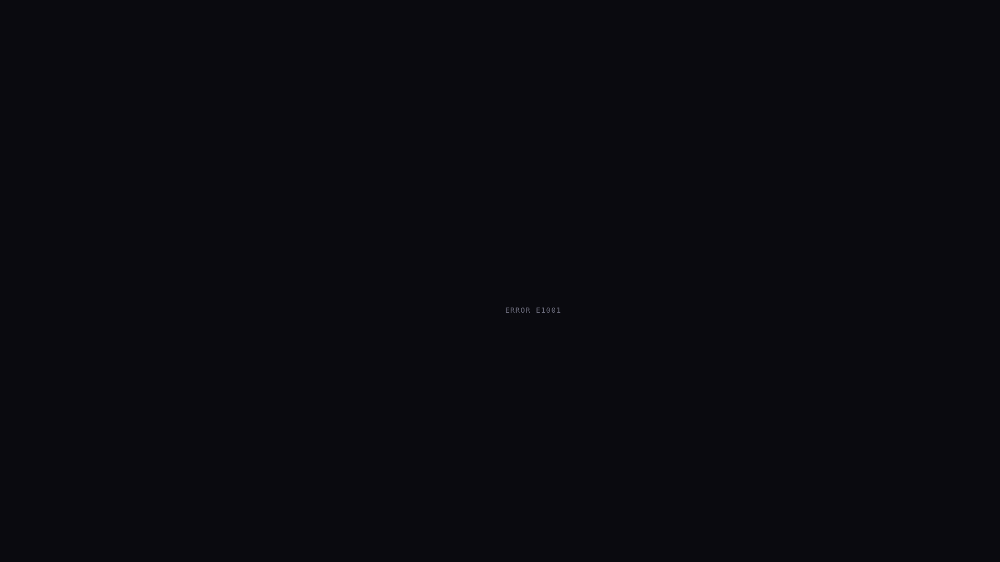
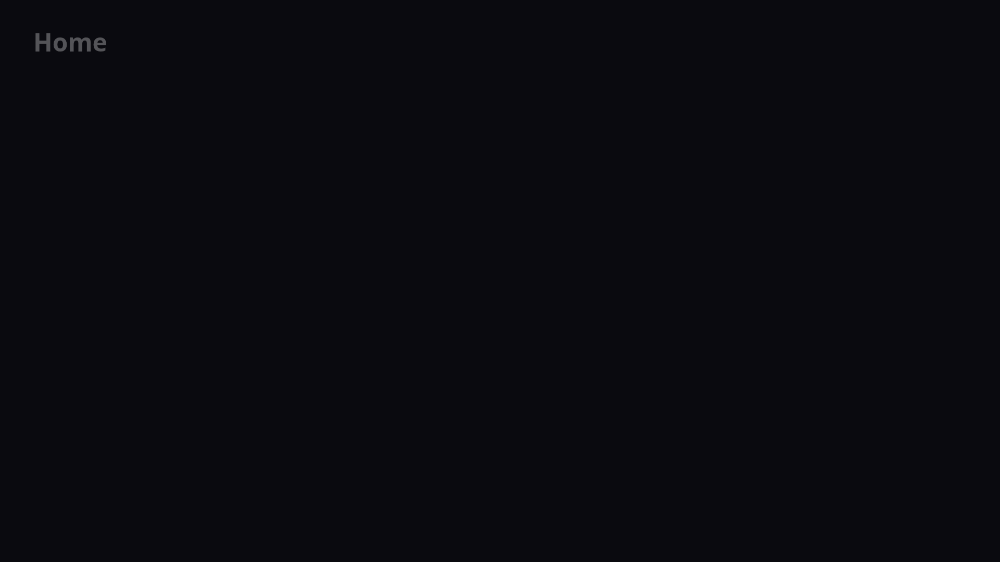

<h1 align="center">Jellyfin for Tizen</h1>
<h3 align="center">Part of the <a href="https://jellyfin.org">Jellyfin Project</a></h3>

---

<p align="center">

</p>

## Build Process
_Also look [Wiki](https://github.com/jellyfin/jellyfin-tizen/wiki)._

### Prerequisites
* Tizen Studio 4.6+ with IDE or Tizen Studio 4.6+ with CLI. See [Installing TV SDK](https://developer.samsung.com/smarttv/develop/getting-started/setting-up-sdk/installing-tv-sdk.html).
* Git
* Node.js 20+

### Getting Started

1. Install prerequisites.
2. Install Certificate Manager using Tizen Studio Package Manager. See [Installing Required Extensions](https://developer.samsung.com/smarttv/develop/getting-started/setting-up-sdk/installing-tv-sdk.html#Installing-Required-Extensions).
3. Setup Tizen certificate in Certificate Manager. See [Creating Certificates](https://developer.samsung.com/smarttv/develop/getting-started/setting-up-sdk/creating-certificates.html).
   > If you have installation problems with the Tizen certificate, try creating a Samsung certificate. In this case, you will also need a Samsung account.
4. Clone or download [Jellyfin Web repository](https://github.com/jellyfin/jellyfin-web).

   > It is recommended that the web version match the server version.

   ```sh
   git clone -b release-10.10.z https://github.com/jellyfin/jellyfin-web.git
   ```
   > Replace `release-10.10.z` with the name of the branch you want to build.

   > You can also use `git checkout` to switch branches.
5. Clone or download Jellyfin Tizen (this) repository.
   ```sh
   git clone https://github.com/jellyfin/jellyfin-tizen.git
   ```

### Build Jellyfin Web

```sh
cd jellyfin-web
npm ci --no-audit
USE_SYSTEM_FONTS=1 npm run build:production
```

> You should get `jellyfin-web/dist/` directory.

> `USE_SYSTEM_FONTS=1` is required to discard unused fonts and to reduce the size of the app. (Since Jellyfin Web 10.9)

> Use `npm run build:development` if you want to debug the app.

If any changes are made to `jellyfin-web/`, the `jellyfin-web/dist/` directory will need to be rebuilt using the command above.

### Prepare Interface

```sh
cd jellyfin-tizen
JELLYFIN_WEB_DIR=../jellyfin-web/dist npm ci --no-audit
```

> You should get `jellyfin-tizen/www/` directory.

> The `JELLYFIN_WEB_DIR` environment variable can be used to override the location of `jellyfin-web`.

> Add `DISCARD_UNUSED_FONTS=1` environment variable to discard unused fonts and to reduce the size of the app. (Until Jellyfin Web 10.9)  
> Don't use it with Jellyfin Web 10.9+. Instead, use `USE_SYSTEM_FONTS=1` environment variable when building Jellyfin Web.

If any changes are made to `jellyfin-web/dist/`, the `jellyfin-tizen/www/` directory will need to be rebuilt using the command above.

### Build WGT

> Make sure you select the appropriate Certificate Profile in Tizen Certificate Manager. This determines which devices you can install the widget on.

```sh
tizen build-web -e ".*" -e gulpfile.babel.js -e README.md -e "node_modules/*" -e "package*.json" -e "yarn.lock" -e "atflix.config*.json"
tizen package -t wgt -o . -- .buildResult
```

> You should get `Jellyfin.wgt`.

## Deployment

### Deploy to Emulator

1. Run emulator.
2. Install package.
   ```sh
   tizen install -n Jellyfin.wgt -t T-samsung-5.5-x86
   ```
   > Specify target with `-t` option. Use `sdb devices` to list them.

### Deploy to TV

1. Run TV.
2. Activate Developer Mode on TV. See [Enable Developer Mode on the TV](https://developer.samsung.com/smarttv/develop/getting-started/using-sdk/tv-device.html#Connecting-the-TV-and-SDK).
3. Connect to TV with one of the following options:
   * Device Manager from `Tools -> Device Manager` in Tizen Studio.

   * sdb:
      ```sh
      sdb connect YOUR_TV_IP
      ```
4. If you are using a Samsung certificate, allow installs onto your TV using your certificate with one of the following options:
   > If you need to change or create a new Samsung certificate (see [Getting-Started](#getting-started) step 3), you will need to [re-build WGT](#build-wgt) once you have the Samsung certificate you'll use for the install.

   * Device Manager from `Tools -> Device Manager` in Tizen Studio:
      * Right-click on the connected device, and select `Permit to install applications`.

   * Tizen CLI:
      ```sh
      tizen install-permit -t UE65NU7400
      ```
      > Specify target with `-t` option. Use `sdb devices` to list them.

   * sdb:
      ```sh
      sdb push ~/SamsungCertificate/<PROFILE_NAME>/*.xml /home/developer
      ```
5. Install package.
   ```sh
   tizen install -n Jellyfin.wgt -t UE65NU7400
   ```
   > Specify target with `-t` option. Use `sdb devices` to list them.

## Quick Reinstall Script

A convenience script is provided to rebuild and reinstall AT Flix on your Samsung TV in one step.

### Prerequisites
- Your Samsung TV must be in **Developer Mode** and on the same Wi-Fi network
- Tizen Studio CLI must be installed at `~/tizen-studio` (the installer is auto-detected)

### Usage

```sh
./reinstall.sh
```

The script will:
1. **Auto-detect** your Samsung TV on the local network
2. **Connect** via `sdb`
3. **Build** the web assets (`npm run build`)
4. **Package** the Tizen WGT file
5. **Uninstall** the old app
6. **Install** the new AT Flix app

### Local config (server preload, IMDb ratings)

Private per-install settings go in `atflix.config.json` (gitignored, keep it local; see `atflix.config.example.json`):

```json
{
    "defaultServer": "https://jellyfin.example.com",
    "omdbApiKey": "your-omdb-api-key"
}
```

or the `ATFLIX_DEFAULT_SERVER` / `ATFLIX_OMDB_API_KEY` environment variables. The build injects them into `www/index.html` as `window.ATFLIX_LOCAL_CONFIG`; the config file itself is excluded from the package.

- `defaultServer`: a fresh install opens straight on this server's sign-in screen. The build looks up the server's ID (it must be reachable); `theme/default-server.js` adds it on first launch and leaves a server already added on the TV alone.
- `omdbApiKey`: shows the IMDb rating on detail pages (`theme/imdb-rating.js`), fetched from [OMDb](https://www.omdbapi.com/apikey.aspx) (free key, 1,000 requests a day) and cached for a week per title.

### Manual Reinstall (if script fails)

If you prefer to run the steps manually:

```sh
# Build
npm run build

# Package
tizen build-web -e ".*" -e gulpfile.babel.js -e README.md -e "node_modules/*" -e "package*.json" -e "yarn.lock" -e "atflix.config*.json"
tizen package -t wgt -s apps2samsung -o . -- .buildResult

# Install (replace QN55Q70AAGXZD with your TV model)
tizen uninstall -t QN55Q70AAGXZD -p AprZAARz4r.Jellyfin
tizen install -n ATFlix.wgt -t QN55Q70AAGXZD
```

---

## Screenshots

These are design mockups (`screenshots/mockup.html`), not captures of the running app.

### Home Screen
Cinematic hero banner with horizontal scrollable poster rows and snap-to-focus.


### Detail Page
Full-bleed backdrop with floating info panel, cast row, and similar items.


### Error Handling
Explicit error screen with friendly message, error code, retry button, and expandable technical details, shown when the app fails to boot. Non-fatal errors go to the debug overlay.



### Debug Overlay
Toggle with the `*` (star) key on your Samsung remote. Shows last 100 logs, focused element info, and performance metrics.



---

## UI Customization & Debug

This fork includes a cinematic Netflix-style theme and a debug system.

### Theme Features
- Dark cinematic palette. The build recolors jellyfin-web's blue accent to the AT Flix accent variables (`recolorCss` in `gulpfile.babel.js`), so buttons, progress bars, checkboxes and the player follow it
- Noto Sans bundled in `theme/fonts/` (SIL OFL 1.1); jellyfin-web is built with system fonts and sets none
- White focus everywhere: a thin ring around posters, a white fill on buttons, tabs and pickers
- Item backdrop art behind library and detail pages, on by default (Settings → Display → Backdrops)
- Sign-in screen with the Quick Connect code shown automatically next to the password form; the app signs in by itself once the code is approved (`theme/login.js`)
- The native `alert()` popup, which freezes the app on Tizen 3–7, is replaced by a non-blocking dialog (`theme/tv-alert.js`)
- Adjustable grid density (compact / comfortable / spacious)

### Performance on the TV
jellyfin-web treats every TV as a slow device: posters don't zoom and focus is not animated. The theme keeps that model: no extra GPU layers per card, no animated shadows, no `backdrop-filter` blur, and no scroll-snap or smooth-scroll overrides fighting jellyfin's own focus scrolling.

### Customization
Theme settings are stored in `localStorage` under key `at-flix-theme`.
You can customize:
- Background and surface colors
- Accent color (applies to jellyfin-web's own UI too)
- Card border radius
- Animation speed
- Grid density

### Debug Overlay
Press the `*` (star) key on the Samsung remote (or F12 in browser) to open the debug overlay.
It shows:
- Last 100 log entries
- Currently focused element info
- Performance metrics

### Error Handling
Uncaught errors and unhandled promise rejections are logged with their code, message and stack, and listed in red in the debug overlay. They don't interrupt the UI: jellyfin-web raises several harmless ones on the TV's older Chromium (e.g. MediaSession `seekto` is unsupported on Tizen 6.0).

If the app never renders a page within 20 seconds, a full-screen error page is shown with:
- Friendly error message
- Error code (`E3001` for a failed boot)
- Retry button
- Expandable technical details, including the errors logged during boot

Press `0` within 5 seconds of launch to start in safe mode (theme CSS disabled).

### Tizen 6.0 compatibility
2021 TVs run Tizen 6.0, whose web engine is Chromium 76. Theme CSS must avoid newer features such as `inset`, flexbox `gap`, `aspect-ratio`, `clamp()`/`min()`/`max()` and `:is()`/`:where()`.
